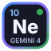

<div align="center">



# Antigravity Periodic Model Selector

**在 Google Antigravity 中以「化学元素周期表」选择 Google Gemini 模型，非 Google 模型保持原生体验。**

[](#)
[](#各系统安装方法)
[](#)
[](LICENSE)

</div>

---

## 核心特性

Google 在 **Gemini 4** 世代采用**化学元素周期表**命名模型（如 `1 · H` Hydrogen、`6 · C` Carbon、`10 · Ne` Neon、`18 · Ar` Argon）。本插件为 Antigravity 桌面客户端提供了一套零依赖、非侵入式的元素周期表模型选择器：

1. **Google 模型专属元素周期表**：
   - 当输入框当前选中的是 **Google / Gemini 模型** 时，点击模型选择器直接从按钮位置以弹簧缩放动画展开 **18 列元素周期表浮窗**（无原生列表闪烁），关闭时平滑收回；
   - 自动高亮当前账号下的 Gemini 4 元素模型（含 `1 H 氢`、`6 C 碳`、`10 Ne 氖`、`18 Ar 氩`，并内置全部 118 种元素，自动兼容未来新发布的 Google 元素模型）；
   - 周期表顶部凹槽区域内置 **「GEMINI 4 元素矩阵」快捷总览栏**，可在一处并排对比和一键切换核心元素模型；
   - 下方科学级元素铭牌展示**原子序数、元素符号、标准原子量、电子层排布式**（如 `[Ne] 3s² 3p⁶`）以及模型定位说明。
2. **同色系流光圆球滑钮调节思考程度（Thinking Effort）**：
   - 在下方元素长框内直接拖动或点击纯白圆形滑钮即可平滑调节思考程度（`低 / 中 / 高 / 极高`），也支持直接按键盘 **`←` / `→` 左右方向键**微调；
   - **元素同色系 + 最高档流动光效**：滑钮左侧填充色自动匹配当前元素的主题色（右侧保持无色浅灰底轨与内置档位圆点），滑到最高思考程度时呈现**持续向右流动的绚丽渐变光流**，升降档位均零闪烁；
   - **零闪烁驻留**：切换模型或调节思考程度后，元素周期表浮窗保持打开、原地丝滑刷新，仅在点击浮窗外部空白处或按 `Esc` 时关闭。
3. **深色 / 浅色与中英文一键切换**：
   - 自动适配 Antigravity 主题，同时在右上角提供 **`🌙 深色 / ☀️ 浅色`** 与 **`EN / 中文`** 切换按钮及 **`4 周期 | 全表 118`** 视图切换，偏好自动记忆。
4. **非 Google 模型 100% 保持原样**：
   - 当切换到 Claude、GPT 等非 Google 模型后，再次点击模型选择器将**完全保持 Antigravity 原生下拉列表**，不做任何拦截；
   - 在周期表浮窗中也可随时点击底部「其他模型」标签或右上角 **「原生列表 ↗」** 切回原生菜单。
5. **自适应窗口缩放与一键从 GitHub 更新**：
   - 打开元素周期表期间拖动调整 Antigravity 窗口或分栏大小，浮窗会自动等比缩放与重定位，永不裁剪；
   - 点击右下角 **`↻ 一键更新`**（或在侧边栏面板中点击），即可直接从 GitHub 检测、校验并热更新到最新版本（按住 `Shift` 点击可强制覆盖同步）。
6. **零外部依赖、不修改 `app.asar`**：
   - 纯 Node.js + Shadow DOM 样式隔离，客户端升级后不会丢失。

---

## 各系统安装方法

**前置要求**：
- 已安装 **Antigravity Desktop App**（推荐 `2.33.0+`）
- 已安装 **Python 3.10+**（用于执行跨平台安装与管理脚本 `manage.py`）

> **关于 Antigravity 2.33+ 调试端口说明**：  
> 从 Antigravity 2.33.0 起，内嵌 UI 插件需要客户端携带本地回环调试参数 `--remote-debugging-port=0 --remote-debugging-address=127.0.0.1` 启动（如果你已经安装过 Antigrative Dashboard，快捷方式通常已配置好，可直接共用）。

### 1. Windows 安装

打开 PowerShell，克隆或解压本项目后执行：

```powershell
git clone https://github.com/Xuyeppin/antigravity-periodic-selector.git
cd antigravity-periodic-selector

# 方式 A：使用 Python 安装脚本
python manage.py install

# 方式 B：使用 PowerShell 脚本
.\install.ps1
```

- 如果你的 Antigravity 桌面/开始菜单快捷方式尚未添加调试参数，可在快捷方式「属性 → 目标」末尾加上：
  ```text
  --remote-debugging-port=0 --remote-debugging-address=127.0.0.1
  ```
  或者直接运行以下命令启动客户端：
  ```powershell
  python manage.py launch
  ```

### 2. Linux (Ubuntu / Debian / Arch / Fedora 等) 安装

在终端中克隆或解压本项目后执行：

```bash
git clone https://github.com/Xuyeppin/antigravity-periodic-selector.git
cd antigravity-periodic-selector

# 方式 A：使用 Python3 安装（会自动配置 ~/.local/share/applications/antigravity.desktop 启动参数）
python3 manage.py install

# 方式 B：使用 Shell 脚本
sh install.sh
```

- 安装完成后，**完全退出并重新从应用菜单打开 Antigravity**（或直接在终端运行 `python3 manage.py launch` 启动）。

### 3. macOS 安装

在终端中克隆或解压本项目后执行：

```bash
git clone https://github.com/Xuyeppin/antigravity-periodic-selector.git
cd antigravity-periodic-selector

python3 manage.py install
# 或
sh install.sh
```

- 完全退出 Antigravity（`⌘Q`），然后通过以下命令带回环调试端口启动：
  ```bash
  python3 manage.py launch
  ```

---

## 如何使用

1. **打开元素周期表**：
   - 当输入框下方的模型按钮显示为任意 **Google Gemini 模型**（例如 `Gemini 4 Neon`、`Gemini 4 Argon`、`Gemini 4 Hydrogen`、`Gemini 3.8 Flash`）时，**点击该模型按钮**即可弹出元素周期表。
2. **切换 Google 元素模型**：
   - 点击周期表中的高亮元素格（如 `1 H`、`10 Ne`、`18 Ar`）或顶部凹槽「GEMINI 4 元素矩阵」中的快捷卡片，即可立即切换到该模型；
   - 切换后浮窗**不会立即消失**，方便继续微调思考程度或对比其他元素；点击浮窗外部空白处或按 `Esc` 即可关闭。
3. **调节思考程度（Thinking Effort）**：
   - 在下方元素详情长框底部的思考程度栏中，**拖动白色圆形滑钮**、**点击档位文字（`低 / 中 / 高 / 极高`）**，或直接按键盘 **`←` / `→` 方向键**，即可实时切换当前模型的思考程度；到达最高档时自动触发流光渐变动画。
4. **切换视图、主题与语言**：
   - 点击顶部 **`4 周期 | 全表 118`** 切换前 4 周期紧凑视图与完整 118 元素周期表；
   - 点击 **`🌙 深色 / ☀️ 浅色`** 自由切换深浅主题，点击 **`EN / 中文`** 切换中英文界面（均自动保存）。
5. **切换到非 Google 模型（Claude / GPT 等）**：
   - 点击周期表底部的「其他模型」标签，或点击右上角 **「原生列表 ↗」** 即可切换到 Claude / GPT 等模型；
   - 处于非 Google 模型时，点击模型按钮将完全使用 Antigravity 原生列表；当你再次从原生列表切回任意 Google 模型后，下一次点击模型按钮又会自动启用元素周期表。
6. **侧边栏扩展面板（可选）**：
   - 点击 Antigravity 右上角展开右侧辅助栏 → **＋ → Extensions → Periodic Model Selector**，也可在侧边栏中打开常驻元素周期表参考面板。

---

## 常用管理命令

在项目根目录下运行（Linux / macOS 请将 `python` 替换为 `python3`）：

| 操作 | 命令 | 说明 |
| :--- | :--- | :--- |
| **安装 / 更新插件** | `python manage.py install` | 复制插件到 `~/.gemini/config/plugins/antigravity-periodic-selector` |
| **查看运行状态** | `python manage.py status` | 检查插件安装状态与当前挂载窗口数（`state: "mounted"` 表示已挂载） |
| **带调试参数启动** | `python manage.py launch` | 使用 `--remote-debugging-port=0 --remote-debugging-address=127.0.0.1` 启动客户端 |
| **卸载插件** | `python manage.py uninstall` | 从 Antigravity 插件目录彻底移除本插件 |
| **运行单元测试** | `node --test tests/elements.test.mjs` | 运行 118 元素与模型/思考档位解析测试套件 |

---

## 目录结构

```text
antigravity-periodic-selector/
├── assets/
│   └── logo.svg                 # 插件图标
├── compat/
│   ├── elements.cjs             # 118 号化学元素数据、Gemini 4 元素元数据与模型识别器
│   ├── periodic-widget.cjs      # Shadow DOM 元素周期表浮窗与 Base UI 思考档位同步组件
│   ├── runtime-ui.mjs           # 零依赖本地回环 CDP 自动注入器与热更新桥接
│   └── updater.mjs              # 零依赖 GitHub Release 检测与原子一键更新器
├── sidecars/
│   └── panel/
│       ├── sidecar.json         # Antigravity Sidecar 声明文件
│       ├── main.mjs             # Sidecar 本地服务与后台挂载进程
│       └── index.html           # 右侧辅助栏常驻预览面板
├── tests/
│   └── elements.test.mjs        # 自动化单元测试
├── manage.py                    # 跨平台安装 / 状态 / 启动 / 卸载工具
├── install.ps1 / uninstall.ps1  # Windows PowerShell 快捷脚本
├── install.sh / uninstall.sh    # Linux / macOS Shell 快捷脚本
├── plugin.json                  # Antigravity 插件清单
└── README.md                    # 说明文档
```

## 开源许可

本项目采用 [MIT License](LICENSE) 许可协议。
